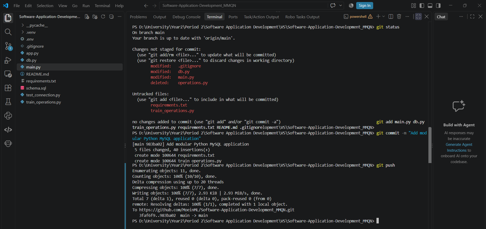
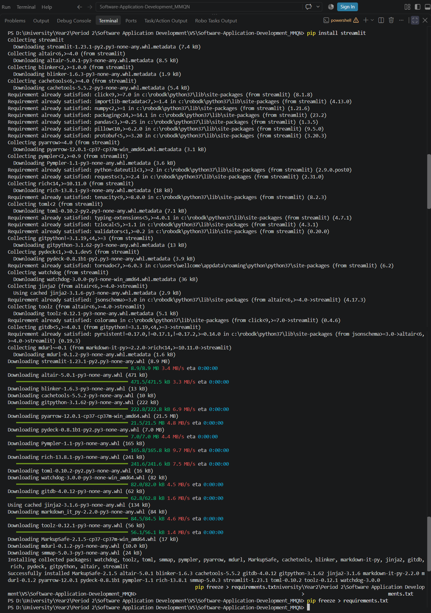
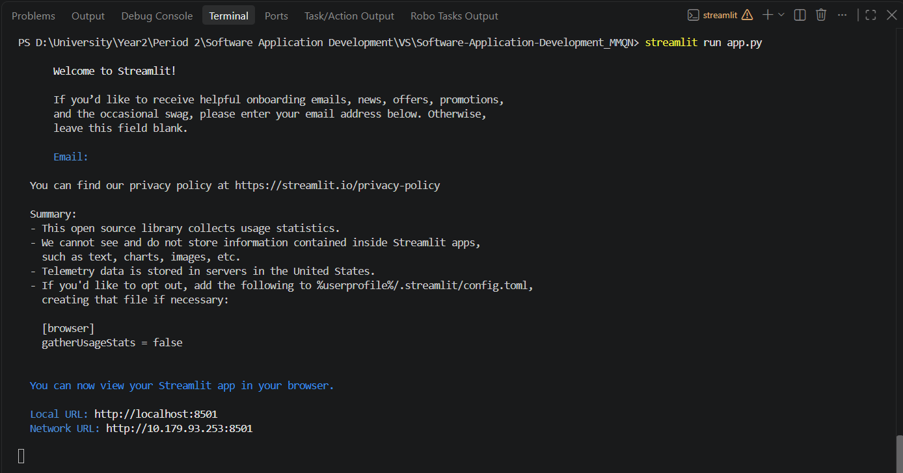
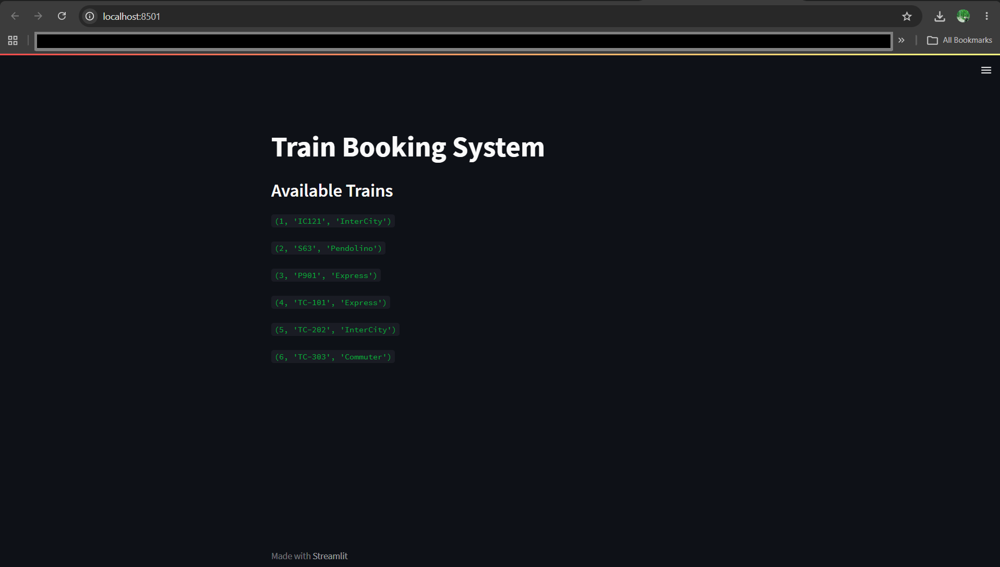
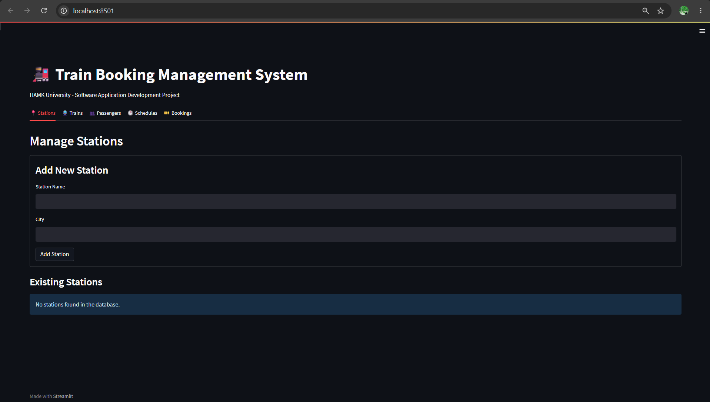
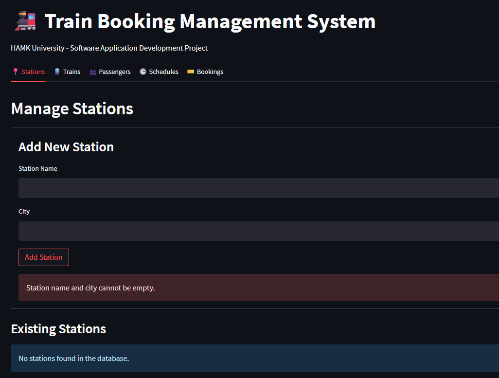
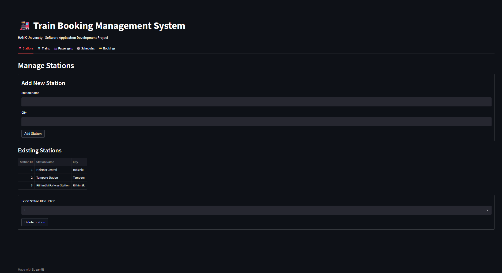
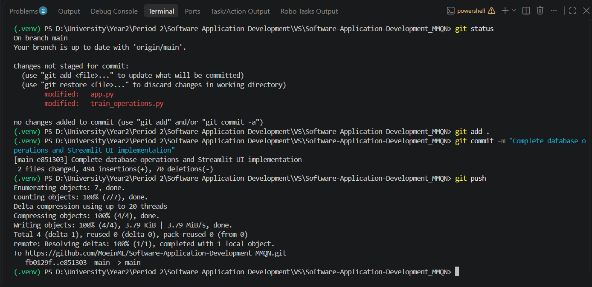
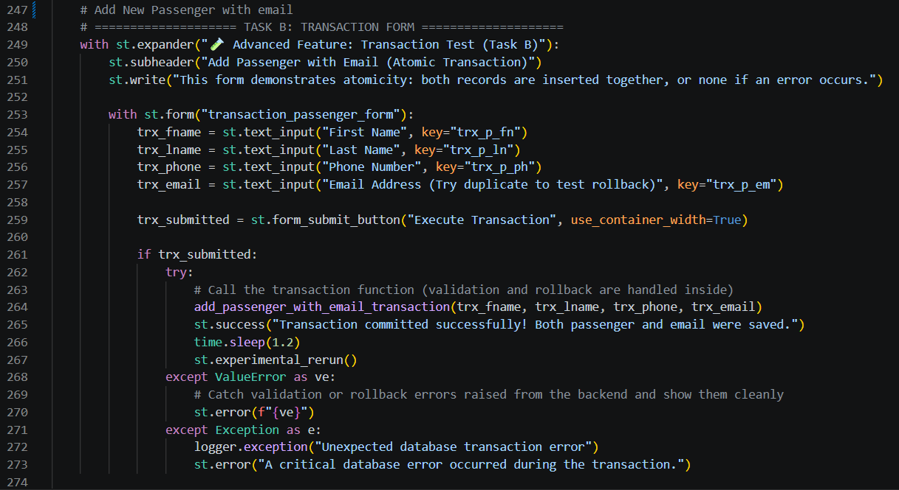
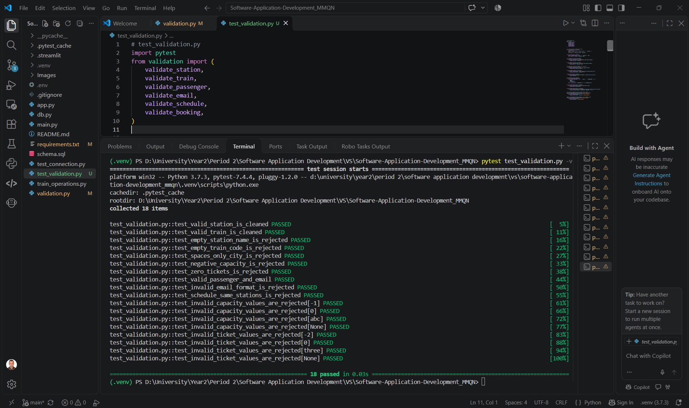

# Train Booking Project
## 📋 Table of Contents
- [Project Overview](#project-overview)
- [Team Members](#team-members)
- [Weekly Progress & Milestones](#weekly-progress--milestones)
  - [Week 1: Project Scope, Requirement Analysis & Agile Setup](#week-1-project-scope-requirement-analysis--agile-setup)
  - [Week 2: Database Connectivity & Python Environment Setup](#week-2-database-connectivity--python-environment-setup)
  - [Week 3: Modular Architecture, Environment Security & Streamlit Integration](#week-3-modular-architecture-environment-security--streamlit-integration)
  - [Week 4: Reliable Applications](#week-4-reliable-applications)
  - [Week 5: Finding & Preventing Bugs, Automated Testing with `pytest`](#week-5-finding--preventing-bugs-automated-testing-with-pytest)

  - [Week 8: Final Presentation & Live Demo](#week-8-final-presentation--live-demo)

---

## 📖 Project Overview
Managing train schedules, seat allocations, station connections, passenger information, and ticket bookings manually or through raw SQL queries is complex and prone to errors. This application addresses these challenges by delivering an intuitive Graphical User Interface (GUI) built with **Streamlit**, connected directly to a **MySQL** database backend.

---

## 👥 Team Members
- **Moein Lahashinejad**
- **Bach Quyen**
- **Le Minh**
- **Navid Behazin**

---

## 🗓️ Weekly Progress & Milestones

### Week 1: Project Scope, Requirement Analysis & Agile Setup

#### 1. Group Discussion (Lecture 1)
* **Who would use the application?**
  * Train station operators, booking administrators, and passengers who need to view, book, and manage train tickets seamlessly.
* **Which ONE main entity would you manage?**
  * **BOOKING** (as the core transaction entity linking passengers, schedules, and specific seats).
* **What are the essential features?**
  * Registering passengers and viewing active itineraries.
  * Searching train schedules between specific stations and dates.
  * Reserving seats and updating booking statuses (e.g., Pending to Confirmed).
  * Canceling ticket reservations and removing logs safely.
* **What could go wrong if you start coding immediately?**
  * Lack of clear architecture leads to tight coupling between UI and SQL logic.
  * Risk of security flaws, such as hardcoding database credentials.
  * Misaligned database schemas and unhandled constraint violations during CRUD operations.
  * Wasted effort rebuilding features due to unverified user requirements.

---

#### 2. Group Activity & Project Setup (Lecture 2)
* **Selected Project:** End-to-End Train Booking Management System (reusing the normalized 3NF MySQL schema `trainbookingsystem`).
* **Main Entity & User:** `BOOKING` entity managed by Passengers and Booking Administrators.
* **Requirements:**
  * **Functional Requirement 1:** Passengers must be able to search for available train schedules by specifying departure station, arrival station, and date.
  * **Functional Requirement 2:** The system must allow users to reserve available seats and generate a unique booking record linked to the passenger ID.
  * **Functional Requirement 3:** Booking administrators must be able to update booking statuses (e.g., Pending to Confirmed).
  * **Functional Requirement 4:** Passengers must be able to cancel an active booking and free up the allocated seat.
  * **Non-Functional Requirement (Security & Performance):** Database connection credentials must be securely stored in environment variables (`.env`), and search queries must return within 2 seconds under standard load.
* **Kanban Board Initial Tasks:**
  1. Setup repository structure and `.gitignore` file.
  2. Configure Python virtual environment (`.venv`) and `.env` file.
  3. Write modular MySQL database connection module (`db.py`).
  4. Develop data operation module (`train_operations.py`).
  5. Build entry point application file (`main.py`).
  6. Design multi-page Streamlit dashboard interface.
  7. Implement input validation and `pytest` automated test suite.
* **Initial Responsibilities:** Collaborative development model — all team members co-develop and contribute across database connectivity, logic partitioning, UI development, and GitHub workflow.

---

### Week 2: Database Connectivity & Python Environment Setup

---

#### 1. Objectives & Learning Outcomes
* Created a dedicated Python project workspace and configured a virtual environment (`.venv`) for dependency isolation.
* Installed the `mysql-connector-python` package via pip to bridge Python application logic with the MySQL database server.
* Implemented secure database connectivity parameters and tested successful data retrieval.

#### 2. Technical Implementation Steps
* **Virtual Environment & Dependencies:** Set up `.venv` to manage required libraries cleanly and documented dependencies in `requirements.txt`.
* **Database Connection Module (`db.py`):** 
  * Established secure communication with the local MySQL server using `mysql.connector`.
  * Utilized `python-dotenv` to load sensitive database credentials (`root` password) safely from an ignored `.env` file, preventing credentials exposure in version control.
* **Data Operations & Testing (`train_operations.py` & `main.py`):**
  * Created database cursors (`connection.cursor()`) to execute SQL statements.
  * Executed `SELECT` queries and processed query results using `fetchall()` to fetch and display train and booking records.
  * Verified end-to-end execution flow from entry point `main.py` through modular operations.

#### 3. Verification & Deliverables
* Successfully executed test connections and verified live data retrieval from the `trainbookingsystem` database.
* Committed and synchronized all modular code files and configuration templates to the shared GitHub repository.

---

### Week 3: Modular Architecture, Environment Security & Streamlit Integration

---

#### 1. Objectives & Overview
During Week 3, the project evolved from a single-script setup into a maintainable, multi-tier modular architecture. Additionally, security protocols were established for handling database credentials, and a Web Graphical User Interface (GUI) was introduced using **Streamlit** to present live database records in a user-friendly browser interface.

---

#### 2. Technical Implementation & Modular Architecture

The application was structured into three dedicated, single-responsibility modules:
* **`db.py` (Database Connection Layer):** Encapsulates the connection logic to the MySQL database `trainbookingsystem` while securely pulling environment credentials.
* **`train_operations.py` (Data Access Layer):** Contains functions dedicated to executing database queries and retrieving dataset structures.
* **`main.py` (Console Entry Point):** Handles terminal-based execution flow.
* **`app.py` (Streamlit Web Interface):** Integrates the modular backend with Streamlit to render dynamic web pages.

##### Source Code Implementation

**`db.py`**
```python
import mysql.connector
import os
from dotenv import load_dotenv

load_dotenv()

def get_connection():
    return mysql.connector.connect(
        host="localhost",
        user="root",
        password=os.environ["MYSQL_PASSWORD"],
        database="trainbookingsystem"
    )
```

**`train_operations.py`**
```python
from db import get_connection

def get_all_trains():
    connection = get_connection()
    cursor = connection.cursor()
    try:
        cursor.execute("SELECT * FROM train")
        trains = cursor.fetchall()
        return trains
    finally:
        cursor.close()
        connection.close()
```

**`main.py`**
```python
from train_operations import get_all_trains

print("Train Booking System")
trains = get_all_trains()

for train in trains:
    print(train)
```

**`app.py`**
```python
import streamlit as st
from train_operations import get_all_trains

st.title("Train Booking System")
st.subheader("Available Trains")

trains = get_all_trains()

for train in trains:
    st.write(train)
```

---

#### 3. Environment Security & Dependency Management
* **Credential Protection (`.env` & `python-dotenv`):** Sensitive database connection credentials (such as the MySQL `root` password) were stored inside an uncommitted local `.env` file and dynamically loaded at runtime, eliminating hardcoded passwords in source files.
* **Version Control Filtering (`.gitignore`):** Configured `.gitignore` rules to exclude `.venv/`, `.env`, and cache files (`__pycache__/`) from being tracked or pushed to remote repositories.
* **Package Management:** Installed `streamlit` and updated `requirements.txt` (`pip freeze > requirements.txt`) to allow team members to seamlessly reproduce the identical runtime environment.





---

#### 4. Web Interface Execution & Verification
* Launched the Streamlit web application via terminal using `streamlit run app.py`.
* Verified live database records fetched from MySQL and rendered at `http://localhost:8501`.
* Successfully committed and synchronized all modular code files, dependencies, and interface logic to GitHub.





#### 5. Station Management & UI Validation Implementation

To expand the core functionalities of the Streamlit interface beyond basic data viewing, the application was extended to support full **CRUD (Create, Read, Update, Delete)** operations, starting with the **Stations** management module.

- **Interactive Station Entry:** Users can seamlessly add new railway stations by inputting the station name and corresponding city through dedicated form fields.
- **Form Validation & Error Handling:** Built-in safeguards check for empty fields or invalid entries, instantly prompting user-friendly error messages (e.g., preventing blank submissions) to protect database integrity.
- **Dynamic Data Display & Deletion:** The interface renders existing station records in an organized data table alongside an intuitive selection dropdown allowing administrators to safely delete specific station entries by their unique ID.







---

#### 6. Version Control & Synchronization

Following the successful implementation of the station management interface and database operations, all modified source files (`app.py` and `train_operations.py`) were staged, committed, and pushed to the shared GitHub repository to ensure seamless collaboration across the development team.



---

### Week 4: Reliable Applications

---

#### Overview
This week focused on improving the reliability, data integrity, and fault tolerance of the Train Booking System across the business logic, database, and Streamlit user interface layers.

#### Key Accomplishments

##### 1. Input Validation & Business Rules (`validation.py`)
- Created a dedicated, reusable `validation.py` module independent of Streamlit widgets and database connections.
- Implemented validation rules for stations, trains, passengers, emails, schedules, and bookings, including:
  - Rejecting empty or whitespace-only strings using `.strip()`.
  - Enforcing maximum field length constraints aligned with the database schema.
  - Validating numeric ranges and positive values (e.g., train capacity and ticket counts).
  - Checking basic email format and schedule time/station consistency (such as ensuring arrival time is after departure time and departure and arrival stations differ).
- Routed validation checks before opening database connections or executing write operations so invalid inputs fail fast with clear `ValueError` messages.

##### 2. CRUD Reliability & Error Handling (`train_operations.py` & `app.py`)
- Updated CRUD operations across entities so validation errors (`ValueError`), database constraint violations (`IntegrityError`), and unexpected errors are handled cleanly.
- Ensured database cursors and connections are closed reliably in `finally` blocks, while rolling back failed changes when needed.
- Updated Streamlit workflows to present clear, user-friendly feedback for expected input/constraint errors while logging technical exceptions for debugging.

##### 3. Atomic Transaction for Passenger & Email Registration (Task B)
- Updated the schema so passenger emails enforce uniqueness (`UNIQUE`) and cascade on passenger deletion (`ON DELETE CASCADE`) to keep data consistent.
- Implemented `add_passenger_with_email_transaction` using a single database connection with explicit transaction control (`start_transaction()`, `commit()`, and `rollback()`), inserting the passenger record and retrieving `lastrowid` before inserting the associated email.
- Added a dedicated transaction test section in `app.py` to verify atomic commits as well as automatic rollback when validation or constraint errors occur.



### Week 5: Finding & Preventing Bugs, Automated Testing with `pytest`

---

#### 1. Overview
During Week 5, automated unit testing was introduced to verify the pure input-validation functions in `validation.py` without requiring a live database or browser UI[cite: 38, 39]. Using `pytest` inside the project virtual environment (`.venv`), we established repeatable tests for valid cleaned outputs, `ValueError` handling, edge cases, and parameterized invalid values[cite: 20, 34, 35, 39, 45].

---

#### 2. Environment Setup & Dependency Management
- Installed `pytest` (`7.4.4`) into the active project virtual environment (`.venv`)[cite: 20, 44].
- Updated `requirements.txt` so `pytest` is recorded alongside the project dependencies for reproducible test execution across the team[cite: 20].

---

#### 3. Unit Testing Implementation (`test_validation.py`)
Created `test_validation.py` following the **Arrange, Act, Assert** pattern and `pytest` naming conventions (`test_*.py` and `test_*`) to test validation rules across stations, trains, passengers, emails, schedules, and bookings[cite: 22, 32, 45]:
- **Valid Inputs & Cleaned Return Values:** Verified that leading/trailing whitespace is stripped and valid inputs return cleaned values[cite: 34, 45].
- **Blank Input Rejection:** Used `pytest.raises(ValueError, match=...)` to verify that empty fields raise `ValueError` with expected messages[cite: 35, 45].
- **Boundary & Invalid Quantity Cases:** Tested whitespace-only strings as well as negative or zero capacities and ticket counts[cite: 34, 35, 45].
- **Parameterized Testing (`@pytest.mark.parametrize`):** Added parameterized test cases to validate multiple invalid capacity and ticket values cleanly[cite: 37, 45].

##### Source Code Implementation (`test_validation.py`)

```python
# test_validation.py
import pytest
from validation import (
    validate_station,
    validate_train,
    validate_passenger,
    validate_email,
    validate_schedule,
    validate_booking,
)


# 1. Valid entity and cleaned return values
def test_valid_station_is_cleaned():
    # Arrange & Act
    result = validate_station("  Helsinki Central  ", "  Helsinki  ")
    # Assert
    assert result == ("Helsinki Central", "Helsinki")


def test_valid_train_is_cleaned():
    result = validate_train("  IC-101  ", "  InterCity  ", 200)
    assert result == ("IC-101", "InterCity", 200)


# 2. ValueError for blank string fields
def test_empty_station_name_is_rejected():
    with pytest.raises(ValueError, match="Station name cannot be empty"):
        validate_station("", "Helsinki")


def test_empty_train_code_is_rejected():
    with pytest.raises(ValueError, match="Train code cannot be empty"):
        validate_train("", "InterCity", 200)


# 3. Spaces-only strings and negative / zero quantities
def test_spaces_only_city_is_rejected():
    with pytest.raises(ValueError, match="City cannot be empty"):
        validate_station("Helsinki Central", "   ")


def test_negative_capacity_is_rejected():
    with pytest.raises(ValueError, match="Capacity must be greater than zero"):
        validate_train("IC-101", "InterCity", -5)


def test_zero_tickets_is_rejected():
    with pytest.raises(ValueError, match="Number of tickets must be at least 1"):
        validate_booking(1, 1, 0)


# 4. Additional entity validations
def test_valid_passenger_and_email():
    assert validate_passenger("  Ali  ", "  Rezaei  ", "  +358401234567  ") == (
        "Ali",
        "Rezaei",
        "+358401234567",
    )
    assert validate_email("  ali@example.com  ") == "ali@example.com"


def test_invalid_email_format_is_rejected():
    with pytest.raises(ValueError, match="Invalid email format"):
        validate_email("invalid-email")


def test_schedule_same_stations_is_rejected():
    with pytest.raises(ValueError, match="Departure and arrival stations cannot be the same"):
        validate_schedule("08:00:00", "2026-12-01", "10:00:00", 1, 2, 2)


# 5. Advanced: parametrized test for invalid quantity types
@pytest.mark.parametrize("invalid_capacity", [-1, 0, "abc", None])
def test_invalid_capacity_values_are_rejected(invalid_capacity):
    with pytest.raises(ValueError):
        validate_train("IC-101", "InterCity", invalid_capacity)


@pytest.mark.parametrize("invalid_tickets", [-2, 0, "three", None])
def test_invalid_ticket_values_are_rejected(invalid_tickets):
    with pytest.raises(ValueError):
        validate_booking(1, 1, invalid_tickets)
```
#### 4. Test Execution & Verification
- Ran the validation test suite from the project root with `.venv` active using `pytest test_validation.py -v`[cite: 21, 43].
- Verified that all 18 tests passed (`18 passed in 0.03s`) and committed the test suite and updated `requirements.txt` to GitHub for ongoing regression protection[cite: 20, 26, 43].


