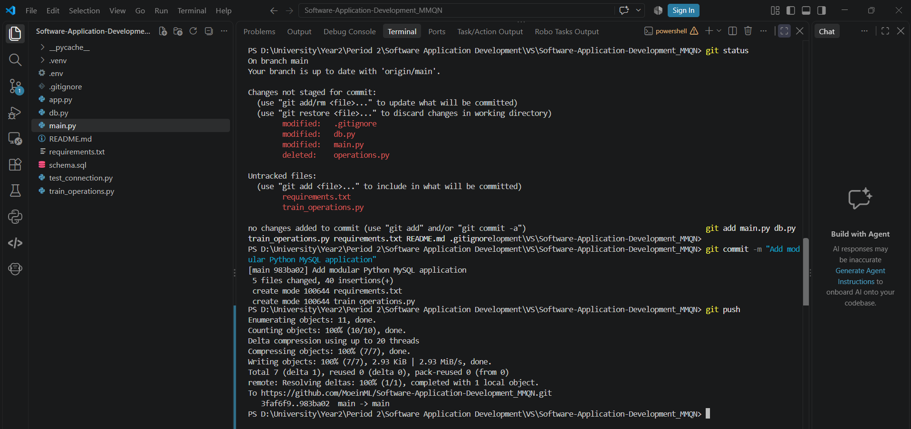
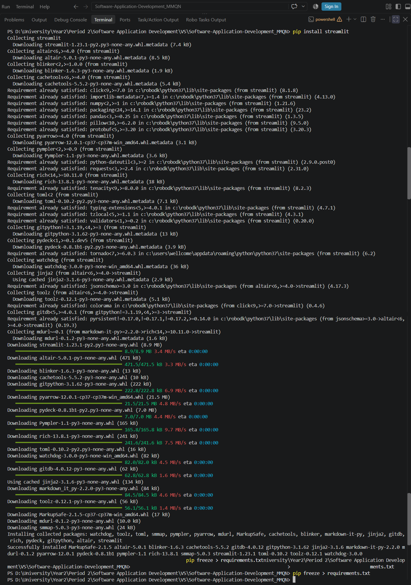
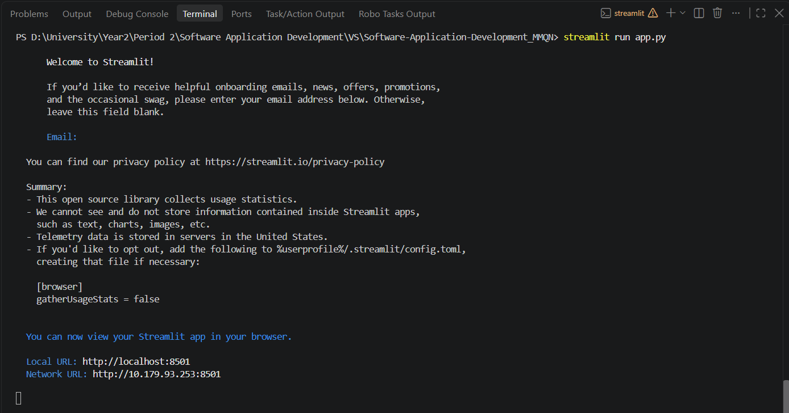
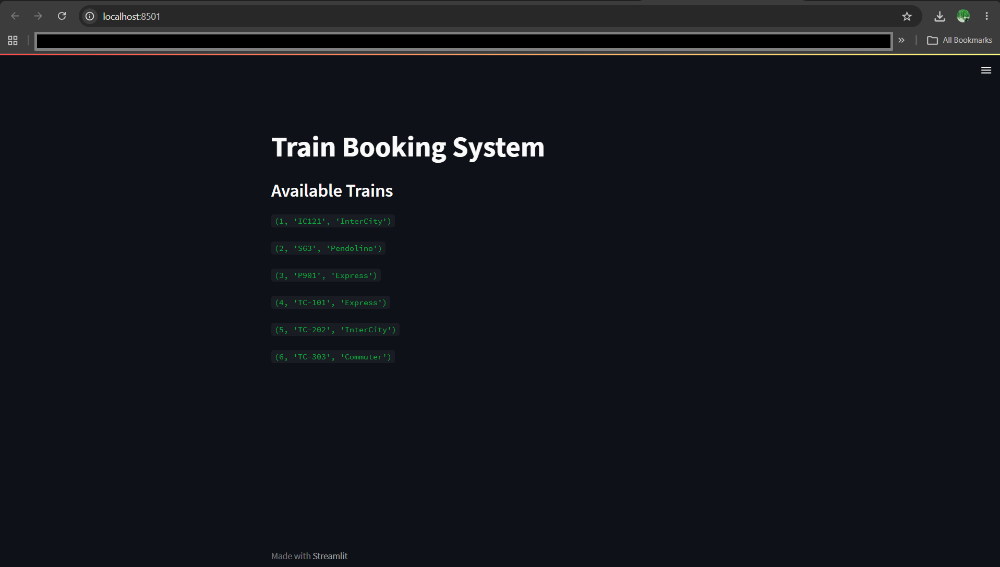

# Train Booking Project
## 📋 Table of Contents
- [Project Overview](#project-overview)
- [Team Members](#team-members)
- [Weekly Progress & Milestones](#weekly-progress--milestones)
  - [Week 1: Project Scope, Requirement Analysis & Agile Setup](#week-1-project-scope-requirement-analysis--agile-setup)
  - [Week 2: Database Connectivity & Python Environment Setup](#week-2-database-connectivity--python-environment-setup)
  - [Week 3: Modular Architecture, Environment Security & Streamlit Integration](#week-3-modular-architecture-environment-security--streamlit-integration)
  - [Week 4: Full Scope CRUD Implementation](#week-4-full-scope-crud-implementation)
  - [Week 5: Streamlit Multi-Page UI Design](#week-5-streamlit-multi-page-ui-design)
  - [Week 6: Input Validation & Automated Testing (pytest)](#week-6-input-validation--automated-testing-pytest)
  - [Week 7: Code Refactoring, Integration & Documentation](#week-7-code-refactoring-integration--documentation)
  - [Week 8: Final Presentation & Live Demo](#week-8-final-presentation--live-demo)

---

## 📖 Project Overview
Managing train schedules, seat allocations, station connections, passenger information, and ticket bookings manually or through raw SQL queries is complex and prone to errors. This application addresses these challenges by delivering an intuitive Graphical User Interface (GUI) built with **Streamlit**, connected directly to a **MySQL** database backend.

---

## 👥 Team Members
- **Moein Lahashinejad**
- **Bach Quyen**
- **Le Minh**
- **Navid Behazin**

---

## 🗓️ Weekly Progress & Milestones

### Week 1: Project Scope, Requirement Analysis & Agile Setup

#### 1. Group Discussion (Lecture 1)
* **Who would use the application?**
  * Train station operators, booking administrators, and passengers who need to view, book, and manage train tickets seamlessly.
* **Which ONE main entity would you manage?**
  * **BOOKING** (as the core transaction entity linking passengers, schedules, and specific seats).
* **What are the essential features?**
  * Registering passengers and viewing active itineraries.
  * Searching train schedules between specific stations and dates.
  * Reserving seats and updating booking statuses (e.g., Pending to Confirmed).
  * Canceling ticket reservations and removing logs safely.
* **What could go wrong if you start coding immediately?**
  * Lack of clear architecture leads to tight coupling between UI and SQL logic.
  * Risk of security flaws, such as hardcoding database credentials.
  * Misaligned database schemas and unhandled constraint violations during CRUD operations.
  * Wasted effort rebuilding features due to unverified user requirements.

---

#### 2. Group Activity & Project Setup (Lecture 2)
* **Selected Project:** End-to-End Train Booking Management System (reusing the normalized 3NF MySQL schema `trainbookingsystem`).
* **Main Entity & User:** `BOOKING` entity managed by Passengers and Booking Administrators.
* **Requirements:**
  * **Functional Requirement 1:** Passengers must be able to search for available train schedules by specifying departure station, arrival station, and date.
  * **Functional Requirement 2:** The system must allow users to reserve available seats and generate a unique booking record linked to the passenger ID.
  * **Functional Requirement 3:** Booking administrators must be able to update booking statuses (e.g., Pending to Confirmed).
  * **Functional Requirement 4:** Passengers must be able to cancel an active booking and free up the allocated seat.
  * **Non-Functional Requirement (Security & Performance):** Database connection credentials must be securely stored in environment variables (`.env`), and search queries must return within 2 seconds under standard load.
* **Kanban Board Initial Tasks:**
  1. Setup repository structure and `.gitignore` file.
  2. Configure Python virtual environment (`.venv`) and `.env` file.
  3. Write modular MySQL database connection module (`db.py`).
  4. Develop data operation module (`train_operations.py`).
  5. Build entry point application file (`main.py`).
  6. Design multi-page Streamlit dashboard interface.
  7. Implement input validation and `pytest` automated test suite.
* **Initial Responsibilities:** Collaborative development model — all team members co-develop and contribute across database connectivity, logic partitioning, UI development, and GitHub workflow.

---

### Week 2: Database Connectivity & Python Environment Setup

---

#### 1. Objectives & Learning Outcomes
* Created a dedicated Python project workspace and configured a virtual environment (`.venv`) for dependency isolation.
* Installed the `mysql-connector-python` package via pip to bridge Python application logic with the MySQL database server.
* Implemented secure database connectivity parameters and tested successful data retrieval.

#### 2. Technical Implementation Steps
* **Virtual Environment & Dependencies:** Set up `.venv` to manage required libraries cleanly and documented dependencies in `requirements.txt`.
* **Database Connection Module (`db.py`):** 
  * Established secure communication with the local MySQL server using `mysql.connector`.
  * Utilized `python-dotenv` to load sensitive database credentials (`root` password) safely from an ignored `.env` file, preventing credentials exposure in version control.
* **Data Operations & Testing (`train_operations.py` & `main.py`):**
  * Created database cursors (`connection.cursor()`) to execute SQL statements.
  * Executed `SELECT` queries and processed query results using `fetchall()` to fetch and display train and booking records.
  * Verified end-to-end execution flow from entry point `main.py` through modular operations.

#### 3. Verification & Deliverables
* Successfully executed test connections and verified live data retrieval from the `trainbookingsystem` database.
* Committed and synchronized all modular code files and configuration templates to the shared GitHub repository.

---

### Week 3: Modular Architecture, Environment Security & Streamlit Integration

---

#### 1. Objectives & Overview
During Week 3, the project evolved from a single-script setup into a maintainable, multi-tier modular architecture. Additionally, security protocols were established for handling database credentials, and a Web Graphical User Interface (GUI) was introduced using **Streamlit** to present live database records in a user-friendly browser interface.

---

#### 2. Technical Implementation & Modular Architecture

The application was structured into three dedicated, single-responsibility modules:
* **`db.py` (Database Connection Layer):** Encapsulates the connection logic to the MySQL database `trainbookingsystem` while securely pulling environment credentials.
* **`train_operations.py` (Data Access Layer):** Contains functions dedicated to executing database queries and retrieving dataset structures.
* **`main.py` (Console Entry Point):** Handles terminal-based execution flow.
* **`app.py` (Streamlit Web Interface):** Integrates the modular backend with Streamlit to render dynamic web pages.

##### Source Code Implementation

**`db.py`**
```python
import mysql.connector
import os
from dotenv import load_dotenv

load_dotenv()

def get_connection():
    return mysql.connector.connect(
        host="localhost",
        user="root",
        password=os.environ["MYSQL_PASSWORD"],
        database="trainbookingsystem"
    )
```

**`train_operations.py`**
```python
from db import get_connection

def get_all_trains():
    connection = get_connection()
    cursor = connection.cursor()
    try:
        cursor.execute("SELECT * FROM train")
        trains = cursor.fetchall()
        return trains
    finally:
        cursor.close()
        connection.close()
```

**`main.py`**
```python
from train_operations import get_all_trains

print("Train Booking System")
trains = get_all_trains()

for train in trains:
    print(train)
```

**`app.py`**
```python
import streamlit as st
from train_operations import get_all_trains

st.title("Train Booking System")
st.subheader("Available Trains")

trains = get_all_trains()

for train in trains:
    st.write(train)
```

---

#### 3. Environment Security & Dependency Management
* **Credential Protection (`.env` & `python-dotenv`):** Sensitive database connection credentials (such as the MySQL `root` password) were stored inside an uncommitted local `.env` file and dynamically loaded at runtime, eliminating hardcoded passwords in source files.
* **Version Control Filtering (`.gitignore`):** Configured `.gitignore` rules to exclude `.venv/`, `.env`, and cache files (`__pycache__/`) from being tracked or pushed to remote repositories.
* **Package Management:** Installed `streamlit` and updated `requirements.txt` (`pip freeze > requirements.txt`) to allow team members to seamlessly reproduce the identical runtime environment.





---

#### 4. Web Interface Execution & Verification
* Launched the Streamlit web application via terminal using `streamlit run app.py`.
* Verified live database records fetched from MySQL and rendered at `http://localhost:8501`.
* Successfully committed and synchronized all modular code files, dependencies, and interface logic to GitHub.






